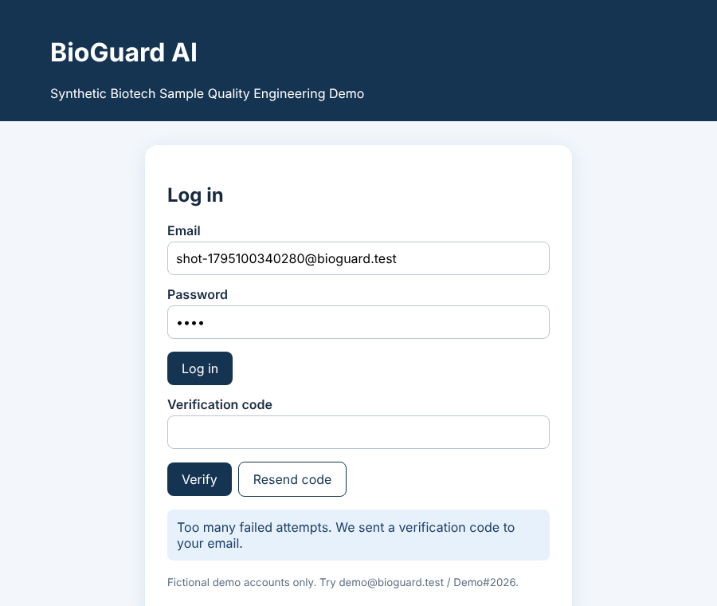
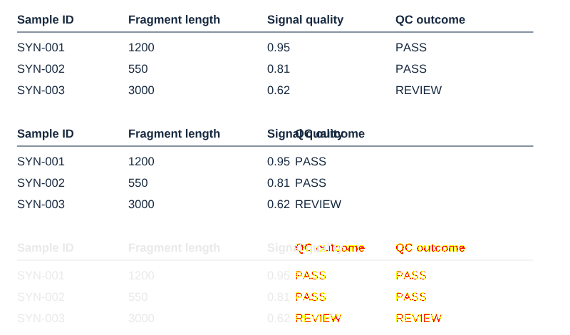
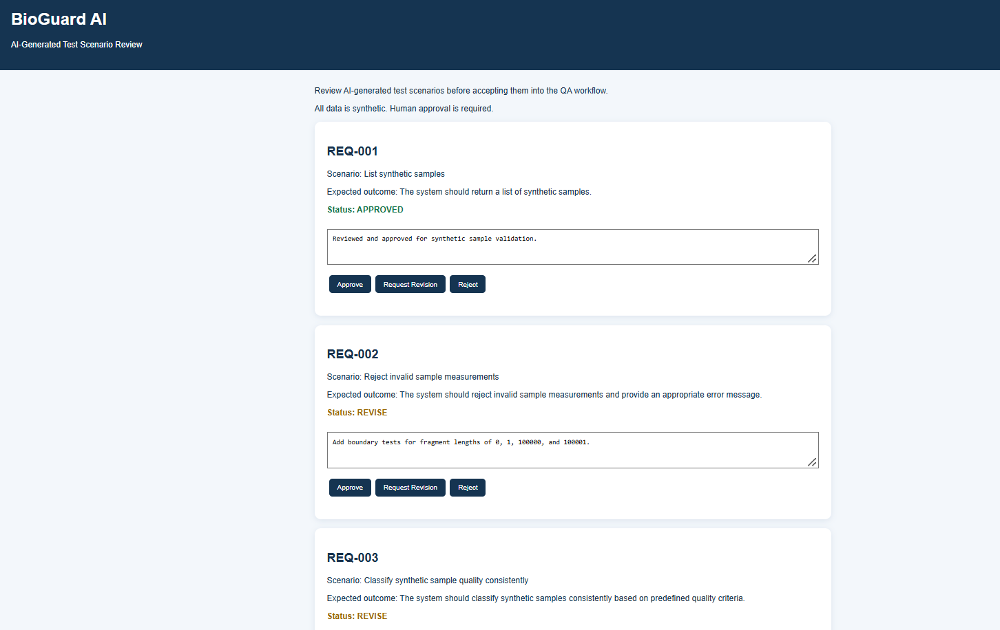

# BioGuard AI

[](https://github.com/swethark105/BioGuard-AI/actions/workflows/quality.yml) [](https://swethark105.github.io/BioGuard-AI/)

🎧 **[Listen and ask about this project](https://swethark105.github.io/BioGuard-AI/voice.html)**: a one-minute spoken intro, plus voice Q&A (voice input works best in Chrome or Edge)

**Synthetic Biotech Sample QA Automation & AI-Assisted Testing**

BioGuard AI is an independent QA engineering portfolio project demonstrating how to build an automated testing framework from scratch for a fictional biotech sample application.

It combines Playwright, TypeScript, API testing, requirements traceability, CI/CD, and AI-assisted test scenario review.

All sample data is fictional. The project is not a diagnostic tool or a validated regulatory quality system.

## Key Features

- **UI and API Automation:** Playwright with TypeScript, using page objects and custom fixtures.
- **Cross-Browser Testing:** User-facing pages tested in Chromium, Firefox and WebKit (Safari).
- **Login Lockout with Email Code:** The 6th failed login emails a verification code; tests read it from a fake inbox (Mailpit).
- **PDF Report Comparison:** The downloadable QC report is compared with an approved version on every run.
- **Data File Checks:** Upload an instrument CSV file; bad files (missing values, wrong header, duplicate IDs) are rejected with a clear error.
- **Voice Q&A:** Ask about the project by voice or by typing; answers come only from checked answers, with no AI cost.
- **Requirements Traceability:** Risk-based test coverage mapped to synthetic requirements.
- **AI-Assisted Testing:** Optional local AI-generated test scenario proposals.
- **Human-in-the-Loop Review:** Approve, request revisions, or reject AI proposals.
- **AI Failure Explanations:** Optional local AI suggests a likely cause for each failed test, clearly labelled as unverified.
- **Playwright Test Agents:** Planner, generator and healer agents (GitHub Copilot in VS Code) plan and write tests, which are kept only after human review.
- **CI/CD Integration:** Automated execution using GitHub Actions and Jenkins.
- **Quality Reporting:** HTML dashboards, Playwright reports, and a trends page across daily runs.
- **Docker:** Reproducible test execution without installing Playwright or Node.js on the host.

## Test Execution Results

| Metric | Latest Verified Run |
|---|---|
| Total Tests | 57 |
| Test runs (all browsers) | 91 |
| Passed | 57 |
| Failed | 0 |
| Requirements Covered | 12/12 |

Results reflect the GitHub Actions run on November 23, 2026. The [daily dashboard](https://swethark105.github.io/BioGuard-AI/) always shows the latest run.

| Test group | Tests | What they check |
|---|---|---|
| API | API-001 to API-007 | Sample data, input validation, audit log, no personal data |
| UI | UI-001, UI-002 | Sample table and PASS / REVIEW labels (Chromium, Firefox, WebKit) |
| AI workflow | AI-001 to AI-005 | Human review of AI proposals; AI failure notes stay unverified |
| Agent-written | AGT-001 to AGT-004 | Every sample row, the 0.80 threshold from both sides, page identity and read-only layout (Chromium, Firefox, WebKit) |
| Seed | SEED-001 | Starting point for the Playwright agents (Chromium, Firefox, WebKit) |
| PDF report | PDF-001 to PDF-004 | Downloaded QC report matches the approved text, the API data and the approved page image |
| Login lockout (API) | AUTH-001, AUTH-002, AUTH-004 to AUTH-010 | Lockout on the 6th failure, emailed code, wrong / expired / reused codes, counter reset, no account enumeration |
| Login lockout (UI) | AUTH-003 | Full journey: 6 failures, code read from the email, account unlocked (Chromium, Firefox, WebKit) |
| Data file checks (API) | DATA-001 to DATA-010, DATA-013 | Correct scores, the 0.80 boundary and rounding, 8 kinds of bad file rejected, nothing saved on error, audit log |
| Data file checks (UI) | DATA-011, DATA-012 | Upload page shows results and readable errors (Chromium, Firefox, WebKit) |
| Voice Q&A (API) | VOICE-001 to VOICE-004 | Right answer for each question, honest "I don't know" for unknown ones, bad input rejected, every answer reachable |
| Voice Q&A (UI) | VOICE-005 to VOICE-011 | Typed questions, answer read aloud (speech mocked), README link, mic shown only where supported (Chromium, Firefox, WebKit), pauses while speaking, the spoken intro, works without a server |

## Quick Start — Run with One Command

**Prerequisite:** Docker Desktop installed and running.

Clone the repository and navigate to the project directory:

```bash
git clone https://github.com/swethark105/BioGuard-AI.git
cd BioGuard-AI
```

Execute the automated test suite:

```bash
docker compose up --build --abort-on-container-exit --exit-code-from qa
```

The command starts three containers: **mailpit** (fake email inbox), **app** (the BioGuard application) and **qa** (Playwright, which runs the tests in all three browsers and generates the quality reports). The first run requires internet access to download dependencies.

**Without Docker (for example in VS Code):** run `npm install` and `npx playwright install` once, start the fake email inbox with `docker compose up -d mailpit` (the login tests are skipped without it), start the app with `npm start`, then in a second terminal run `npm test` (all browsers) or `npm run test:chromium` (quicker, Chromium only), followed by `npm run report`.

### Generated Reports

- `artifacts/quality-dashboard.html` — Test execution summary and requirements traceability.
- `artifacts/playwright-report/index.html` — Detailed Playwright HTML report.
- `artifacts/quality-summary.json` — Machine-readable test results.
- `artifacts/junit.xml` — JUnit test results, used by Jenkins.
- `artifacts/trends.html` — Results and duration across your local Docker runs (`npm run trends`).

## Cross-Browser Testing

The user-facing sample pages (UI, SEED and AGT tests) run in the three browser engines Playwright supports:

| Project | Engine | Real-world browsers |
|---|---|---|
| `chromium` | Chromium | Chrome, Edge |
| `firefox` | Firefox | Firefox |
| `webkit` | WebKit | Safari |

API tests run once, without a browser (`api` project). The AI review dashboard and the PDF report tests run once, in Chromium. The quality dashboard combines each test's results across browsers and shows a **Browser coverage** table, so a failure in only one browser is easy to spot.

## Login Lockout with Email Verification Code

The app has a login page (`/login`) with an account-lockout feature, built to demonstrate how to test authentication end to end.

| Rule | Detail |
|---|---|
| Failed logins 1 to 5 | "Invalid email or password." |
| 6th failed login | Account locked; a 6-digit code is emailed |
| While locked | Only a valid code unlocks the account, even with the correct password |
| Code limits | Expires after 10 minutes, works once, 5 wrong codes cancel it, at most 3 resends |
| Successful login | Resets the failed-attempt counter to 0 |
| Unknown email | Same response as a wrong password, so the form never reveals which accounts exist |



**How the tests stay independent:** every test creates a brand-new user through a test-support endpoint, so lockout state never carries over between tests. A second test-support endpoint expires a code instantly, so the expiry test takes milliseconds instead of 10 minutes. Both endpoints are switched off when `NODE_ENV=production`.

**Try it yourself:**

1. Start the app and the inbox: `docker compose up -d --build app` (Mailpit starts with it).
2. Open http://localhost:3000/login and sign in as `demo@bioguard.test` with a wrong password six times.
3. Open the inbox at http://localhost:8025 and copy the code from the newest email.
4. Enter the code and click **Verify**. The correct password is `Demo#2026`.
5. Stop everything with `docker compose down`. Users and lockouts are kept in memory, so a restart resets them.

### Mailpit: the fake email inbox

[Mailpit](https://mailpit.axllent.org/) is a free email-testing tool. It accepts email like a real mail server but delivers nothing: every message stays in its inbox, where people can read it in a browser and tests can read it through an API. No real email is ever sent.

```
6th failed login  →  app sends the code  →  Mailpit keeps the email  →  test reads the code
                     (SMTP, port 1025)       (inbox, port 8025)         (Mailpit API)
```

**What was added for it**

| Where | What |
|---|---|
| `compose.yaml` | A `mailpit` service (`axllent/mailpit:v1.33.1`) with a health check; the app waits for it to be ready |
| `compose.yaml` | The app sends to it (`SMTP_HOST: mailpit`, `SMTP_PORT: 1025`); the tests read from it (`MAILPIT_URL`) |
| `app/mailer.js` | Sends email with [nodemailer](https://nodemailer.com/); defaults to `localhost:1025` outside Docker |
| `tests/helpers/mailbox.ts` | Reads emails through the Mailpit API: checks it is running, counts emails to an address, and waits for the newest code |
| `fixtures/test-options.ts` | The `mailbox` fixture hands the helper to tests |

| Port | Used for | Open in a browser |
|---|---|---|
| 8025 | Inbox web page and API | http://localhost:8025 |
| 1025 | Receiving email (SMTP) | — |

**How the tests use it**

- `mailbox.count(email)` proves that **no** email was sent after 5 failed logins (AUTH-001). The app finishes sending before it answers the login, so the count is final.
- `mailbox.latestCode(email)` checks the inbox repeatedly (up to 15 seconds) until the email arrives, then takes the 6-digit code from it. There are no fixed waits.
- Each test uses its own new email address, so tests never read each other's emails.

**When Mailpit is not running**

| Where | What happens |
|---|---|
| Docker Compose, GitHub Actions, Jenkins | Login tests **fail**, so a broken setup cannot hide (`REQUIRE_MAILPIT=true`) |
| Your laptop with `npm test` | Login tests are **skipped**, with a message saying how to start Mailpit |

To run the login tests without Docker for the app, start only the inbox with `docker compose up -d mailpit`, then `npm start` and `npm test`.

**Troubleshooting**

| Problem | Fix |
|---|---|
| http://localhost:8025 does not open | `docker compose up -d mailpit`, then check `docker compose ps` |
| `/login` shows `Not found` | Old app image: run `git pull`, then `docker compose up -d --build app` |
| `port is already allocated` | Something else uses port 8025, 1025 or 3000: stop it, or run `docker compose down`. Jenkins builds don't use these ports (`compose.ci.yaml`) |
| Login tests skipped | Mailpit is not running on your laptop: `docker compose up -d mailpit` |

**Why the app is called `bioguard-app` inside Docker:** the tests first reached the app at `http://app:3000`. `.app` is a real internet domain ending, like `.com`, and WebKit (Safari) refuses cookies set directly by a domain ending, so the login journey failed in WebKit only. Renaming the app's Docker hostname fixed it. It was a test-environment issue, not an app bug.

## PDF Report Comparison

The app's **QC Reports** page (`/reports`) offers a **Download sample QC report (PDF)** link. Four tests check it:

- `PDF-001` downloads the report in the browser and compares its text with the approved version in `tests/__snapshots__/pdf-report.spec.ts/sample-qc-report.txt`. If anything differs, the test fails and shows the changed lines.
- `PDF-002` checks it is a real one-page PDF with the right file name and title.
- `PDF-003` checks the report shows the same values as `/api/samples`.
- `PDF-004` checks the report **looks** right: it draws the page as an image and compares it pixel by pixel with the approved image in `tests/__snapshots__/pdf-report.spec.ts/qc-report-page-1.png`.

### Visual check (PDF-004)

The text checks confirm the right words and numbers are in the report, but not where they are on the page. PDF-004 catches layout problems the text cannot show: overlapping or moved columns, missing lines, and wrong sizes or colours.

- **How the page becomes an image:** pdf.js draws the page in Node with the Skia graphics library (`@napi-rs/canvas`), using the fonts bundled with pdf.js, not a browser or system fonts, so the same PDF gives the same image every time (`renderPdfPage` in `tests/helpers/pdf.ts`).
- **Tolerance:** a normal run differs from the approved image by 0 pixels, and one moved column changes about 1,000. The test allows up to 100 different pixels, so tiny anti-aliasing changes never fail it, while real layout changes always do.
- **Where it runs:** on Linux, which means Docker Compose, GitHub Actions and Jenkins. On Windows and macOS it is skipped, because those systems draw text very slightly differently from the Linux image it was approved on.
- **When it fails,** the Playwright report shows three images: expected, actual, and a diff with the changes in red.



*Top: approved image. Middle: the layout defect moves "QC outcome" on top of "Signal quality". Bottom: the diff, with the changes in red and yellow. The text checks still pass here, because the words and their order are unchanged.*

### Approving a change

When the report is meant to change, review the difference, then approve the new version:

- **Text** (`sample-qc-report.txt`): `npx playwright test tests/pdf-report.spec.ts --update-snapshots`
- **Image** (`qc-report-page-1.png`): approve it on Linux, in Docker, so it matches what CI draws:

  ```powershell
  docker compose up -d --build app
  docker compose run --rm -v "${PWD}/tests/__snapshots__:/work/tests/__snapshots__" qa npx playwright test tests/pdf-report.spec.ts --project=chromium --update-snapshots
  ```

Commit the updated baseline files so the change is reviewed in a pull request.

### See the PDF checks catch a defect

| Start the app with | What goes wrong in the PDF | Tests that fail |
|---|---|---|
| `INJECT_REPORT_DEFECT=true` | Signal quality is rounded (0.95 becomes 0.9) | PDF-001, PDF-003 and PDF-004 |
| `INJECT_REPORT_LAYOUT_DEFECT=true` | "QC outcome" overlaps "Signal quality"; the text is unchanged | **Only PDF-004** |

```powershell
$env:INJECT_REPORT_LAYOUT_DEFECT='true'
docker compose up --build --abort-on-container-exit --exit-code-from qa
Remove-Item Env:INJECT_REPORT_LAYOUT_DEFECT
```

## AI-Assisted Testing

BioGuard AI supports optional local AI-generated test scenario proposals using Ollama and `qwen2.5:1.5b`.

AI-generated proposals are not automatically added to the regression suite. They require human review and approval.

The core automation framework works without an AI model or paid AI services. Until you generate your own proposals, the review dashboard shows a built-in set of demo proposals.

### Generate AI Proposals (Optional)

Everything runs in Docker, so you don't need Node.js or Ollama installed on your machine.

1. Start the local Ollama service:

   ```bash
   docker compose --profile ai up -d ollama
   ```

2. Download the model (about 1 GB, first time only):

   ```bash
   docker compose exec ollama ollama pull qwen2.5:1.5b
   ```

3. Generate test scenario proposals:

   ```bash
   docker compose --profile ai run --rm --no-deps -e OLLAMA_URL=http://ollama:11434 qa node ai/suggest-tests.js
   ```

   Proposals are saved to `artifacts/ai-proposals.json` and replace the demo proposals in the dashboard. Generating a new set clears earlier review decisions. Small local models are not always reliable; if no usable proposals come back, run the command again.

4. Review them in the dashboard (see below). To go back to the demo proposals, delete `artifacts/ai-proposals.json`.

To stop Ollama afterwards: `docker compose --profile ai down`.

### Playwright Test Agents (Planner, Generator, Healer)

The project includes Playwright's test agents for **GitHub Copilot in VS Code**. The planner explores the running app and writes a test plan to `specs/`, the generator turns the plan into tests in `tests/agents/`, and the healer fixes tests that break. Agent-written tests are only kept after human review in a pull request.

Setup and usage: [docs/PLAYWRIGHT-AGENTS.md](docs/PLAYWRIGHT-AGENTS.md)

### AI Review Dashboard

The interactive dashboard demonstrates human-in-the-loop validation of AI-assisted test proposals. Reviewers can approve, request revisions, or reject scenarios with documented feedback.



To explore the dashboard locally, start the sample application:

```bash
docker compose up -d --build app
```

Then visit:

`http://localhost:3000/ai-review`

Review decisions are saved to `artifacts/ai-reviews.json`. Running the test suite clears this file first, so every run starts from the same state.

### AI Failure Explanations (Optional)

When tests fail, a local AI model can suggest the likely cause of each failure. It reads the failed test's code, its error message and the linked requirement, and returns a short hypothesis plus one thing to check.

The suggestion is added to the quality dashboard under **Failed tests**, in a yellow box labelled **"AI suggestion — not verified"**. It never changes a test result: pass/fail is always decided by the test assertions, and an engineer must confirm the cause.

1. Run the tests (for example, the defect demonstration below) so there is at least one failure.
2. Make sure Ollama is running and the model is downloaded (steps 1 and 2 under *Generate AI Proposals*).
3. Ask the AI to explain the failures and rebuild the dashboard:

   ```bash
   docker compose --profile ai run --rm --no-deps -e OLLAMA_URL=http://ollama:11434 qa npm run explain
   ```

4. Open `artifacts/quality-dashboard.html`.

The explanation is saved to `artifacts/ai-failure-analysis.json` and is shown only for the test run it was written for. After a new test run, the dashboard hides the old explanation until you run `npm run explain` again. If every test passed, there is nothing to explain and no AI call is made.

The automated tests `AI-004` and `AI-005` use a fake AI server to check that notes are kept only for tests that really failed, are always marked unverified, and that unusable AI output is rejected without touching the test results.

## CI/CD Pipelines

The same Docker-based test suite runs in two CI/CD tools:

- **GitHub Actions** (`.github/workflows/quality.yml`) runs automatically on every push and pull request and uploads the quality reports.
- **Jenkins** (`Jenkinsfile`) runs the suite, shows pass/fail results and trends on each build, and archives the quality dashboard and Playwright report.

### Daily Runs and Published Results

GitHub Actions runs the full suite every day at 10:17 UTC (early morning in the US), as well as after every merge to `main`. Each of these runs publishes its results to GitHub Pages, including runs where tests fail:

- **Quality dashboard:** https://swethark105.github.io/BioGuard-AI/
- **Detailed Playwright report:** https://swethark105.github.io/BioGuard-AI/playwright-report/
- **Trends across runs:** https://swethark105.github.io/BioGuard-AI/trends.html (a result tile per run, run duration, tests that failed at least once, and links to each run's log)

The trends page builds up over time: each published run downloads the history from the site, adds its own result and publishes it again. It keeps the last 90 runs.

To run it now, open the **Actions** tab, choose **BioGuard AI Quality Pipeline**, then **Run workflow**. The page always shows the latest run; earlier runs stay available as downloadable artifacts in the Actions tab.

One-time setup: in the repository **Settings → Pages**, set **Source** to **GitHub Actions**.

### Running in Jenkins

**Requirements:** a Jenkins agent with Docker and Docker Compose v2, plus the Pipeline, Git and JUnit plugins (included in Jenkins' suggested plugins). The HTML Publisher plugin is optional and adds direct links to the reports on each build.

1. In Jenkins, select **New Item**, enter a name such as `BioGuard-AI`, choose **Pipeline** and click **OK**.
2. Under **Pipeline**, set **Definition** to **Pipeline script from SCM**.
3. Choose **Git**, enter `https://github.com/swethark105/BioGuard-AI.git` and set the branch to `*/main`.
4. Leave **Script Path** as `Jenkinsfile` and click **Save**.
5. Click **Build Now**. After the first build, the button changes to **Build with Parameters**.

The Jenkinsfile also schedules a daily build of `main` between 6:00 and 6:59 in the Jenkins server's time zone.

The same Jenkinsfile works as a **Multibranch Pipeline** (each branch is built when it changes; only `main` runs daily) and on **Windows** Jenkins agents, where it uses `bat` instead of `sh`. On Windows, Docker Desktop must be running.

**No host ports in Jenkins builds:** Jenkins adds `compose.ci.yaml`, which removes the app's and Mailpit's ports on the host computer (the tests reach them through Docker's own network). So a build never fails with `port is already allocated` when BioGuard is running on the same computer, or when another build runs at the same time. Your own `docker compose up` still opens ports 3000, 8025 and 1025.

**Keep the branch list short:** a Multibranch Pipeline builds every branch on GitHub, and old branches keep their old Jenkinsfile. Delete branches once they are merged (or turn on **Settings → General → Automatically delete head branches** on GitHub), then click **Scan Multibranch Pipeline Now** in Jenkins to remove their jobs.

To see the defect-detection demo in Jenkins, choose **Build with Parameters** and tick `INJECT_DEMO_DEFECT`. The build fails, and the test results show `API-002` catching the defect.

## Data File Checks

Open `http://localhost:3000/upload` and upload a CSV file with the header `sample_id,signal_1,signal_2,signal_3`. Each sample's score is the average of its three signals, rounded to 2 decimal places; 0.80 or more is PASS, otherwise REVIEW.

A bad file is rejected as a whole with a clear message (for example `Line 2: signal_2 is missing.`) and nothing is saved. Accepted uploads are recorded in the audit log. The test files, good and bad, are in `tests/data/`.

## Voice Q&A

Open `http://localhost:3000/voice` (Chrome or Edge for voice input) and ask a question such as *"Which browsers do you test?"* by typing or with the 🎤 button. The answer is shown and read aloud.

- **No AI and no cost:** speech uses the browser's built-in Web Speech API, and answers come only from the checked list in `app/voice-answers.json`, so nothing is made up.
- **Honest when unsure:** an unknown question gets *"I don't know that yet"* with a link to this README, and is logged at `/api/voice/unanswered` to show which answers to add next.
- **Tested without a microphone:** the tests type the question and replace the browser's speaker with a recorder, so they can check exactly what would be said aloud.

## Defect Detection Demonstration

The project includes an optional defect-injection feature that deliberately introduces a validation error.

For example, the API incorrectly accepts a negative fragment length. The automated test `API-002` detects this failure and links it to high-risk requirement `REQ-002`.

On Windows PowerShell:

```powershell
$env:INJECT_DEMO_DEFECT='true'
docker compose up --build --abort-on-container-exit --exit-code-from qa
Remove-Item Env:INJECT_DEMO_DEFECT
```

On macOS or Linux:

```bash
INJECT_DEMO_DEFECT=true docker compose up --build --abort-on-container-exit --exit-code-from qa
```

This demonstrates how automated testing identifies defects and connects them to requirements.

To see the AI suggest a cause for the failure, run `npm run explain` afterwards (see *AI Failure Explanations*).

## Project Structure

| Folder / File | Purpose |
|---|---|
| `app/` | Synthetic biotech sample application and APIs; `app/qc-report.js` builds the PDF report; `app/auth.js` is the login and lockout feature; `app/mailer.js` sends email |
| `tests/api.spec.ts` | Automated API tests |
| `tests/ui.spec.ts` | Automated UI tests |
| `tests/ai-review.spec.ts` | AI review workflow tests |
| `tests/ai-failure-analysis.spec.ts` | AI failure explanation tests (fake AI server) |
| `tests/agents/` | Tests written by the Playwright agents and reviewed before merging (AGT-001 to AGT-004) |
| `tests/seed.spec.ts` | Seed test the Playwright agents start from |
| `tests/auth-api.spec.ts`, `tests/auth-ui.spec.ts` | Login lockout tests (API rules and the browser journey) |
| `tests/helpers/mailbox.ts` | Reads verification emails from Mailpit (fake inbox) |
| `tests/pdf-report.spec.ts` | PDF report tests; the approved report text and page image are in `tests/__snapshots__/` |
| `tests/helpers/pdf.ts` | Reads a PDF's text and draws its pages as images for comparison (pdf.js) |
| `app/data-upload.js`, `tests/data-upload-api.spec.ts`, `tests/data-upload-ui.spec.ts`, `tests/data/` | Data file checks: CSV upload, validation and its test files |
| `app/voice.js`, `app/voice-answers.json`, `tests/voice-api.spec.ts`, `tests/voice-ui.spec.ts` | Voice Q&A page, its checked answers, and its tests |
| `tests/global-setup.ts` | Resets saved review decisions before each test run |
| `pages/` | Page objects (where things are on each page) |
| `fixtures/test-options.ts` | Custom Playwright fixtures that hand page objects to tests |
| `specs/` | Test plans written by the Playwright planner agent |
| `requirements/requirements.json` | Synthetic requirements and traceability |
| `playwright.config.ts` | Test projects: `api`, `chromium`, `firefox`, `webkit` |
| `ai/suggest-tests.js` | Optional local AI test proposals |
| `ai/explain-failures.js` | Optional local AI explanations for failed tests |
| `scripts/build-report.js` | Quality dashboard generation |
| `scripts/update-history.js` | Run history and trends page |
| `docs/ADLC.md` | AI-assisted development and QA lifecycle |
| `docs/PLAYWRIGHT-AGENTS.md` | How to use the planner, generator and healer agents |
| `docs/QUALITY-AND-REGULATORY-NOTES.md` | Notes on the illustrative quality and regulatory approach |
| `.github/agents/`, `.vscode/mcp.json` | Playwright agent definitions and MCP server setup for VS Code |
| `.github/workflows/quality.yml` | GitHub Actions CI/CD pipeline |
| `.github/workflows/copilot-setup-steps.yml` | Environment for the Copilot coding agent on GitHub |
| `tsconfig.json` | TypeScript settings; `npm run typecheck` checks all test code |
| `Jenkinsfile` | Jenkins CI/CD pipeline |
| `compose.yaml` | Docker services: `mailpit`, `app`, `qa`, and the optional `ollama` |
| `compose.ci.yaml` | Jenkins-only additions: no host ports, so builds never clash |

## Technology Stack

**Playwright (Chromium, Firefox, WebKit) | TypeScript | JavaScript | Node.js | pdf-lib and pdf.js | Mailpit | Web Speech API | Docker | GitHub Actions | Jenkins | GitHub Copilot (Playwright agents) | Ollama (Optional)**

## Project Objective

BioGuard AI demonstrates a practical approach to designing a QA automation framework from scratch, combining deterministic testing, risk-based coverage, automated quality reporting, and responsible AI-assisted test design.

The project uses synthetic data and is intended for learning, demonstration, and portfolio purposes.

## License

Released under the [MIT License](LICENSE).
