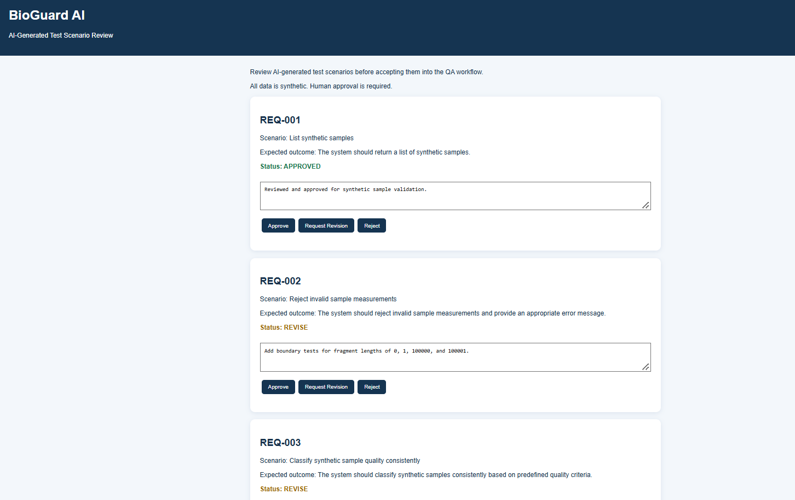

# BioGuard AI Synthetic Biotech Sample QA Engineering Showcase

Independent portfolio project inspired by the QA challenges of scientific software. Uses invented sample data only, no real genomes or patient information. This is not a diagnostic tool, regulatory certification or validated quality system.

## One-command demo (Docker Desktop required)

```bash
docker compose up --build --abort-on-container-exit --exit-code-from qa
```

Run from the extracted project directory. First run needs internet to download the Playwright Docker image and npm dependencies. No Node.js, Playwright, Postman, Python or Ollama installation is required on the host. Docker may use significant disk space; default tests do not download an LLM.

**View the outputs** after the run:
- `artifacts/quality-dashboard.html` — summary and requirements-to-tests traceability
- `artifacts/playwright-report/index.html` — full Playwright HTML report
- `artifacts/quality-summary.json` — machine-readable evidence

Expected clean run: **12 passing tests** covering 5 synthetic requirements. A successful run exits with code 0. If a test fails, the command exits nonzero; the dashboard still gets generated.

## Demonstrate a real defect detection

```bash
INJECT_DEMO_DEFECT=true docker compose up --build --abort-on-container-exit --exit-code-from qa
```

This deliberately enables a fictional validation defect: the API accepts a negative fragment length. `API-002` should fail and link to High-risk `REQ-002`. On Windows PowerShell, use `$env:INJECT_DEMO_DEFECT='true'; docker compose up --build --abort-on-container-exit --exit-code-from qa` and then reset with `Remove-Item Env:INJECT_DEMO_DEFECT`.

## Optional offline-capable local AI

The core test suite is deterministic and **never depends on an LLM**. AI suggestions are explicitly marked as unapproved proposals. If you already have Ollama running locally with model `qwen2.5:1.5b`, run `npm run ai` (requires Node locally). Or use Docker only:

```bash
docker compose --profile ai up -d ollama
docker compose exec ollama ollama pull qwen2.5:1.5b
docker compose run --rm -e OLLAMA_URL=http://ollama:11434 qa node ai/suggest-tests.js
```

Note: the `qa` service normally depends on `app`, so Docker starts the app if needed. Local AI model download is one-time, requires internet, and can be slow on 8 GB machines. Output: `artifacts/ai-proposals.json`. AI suggestions are never silently promoted to approved tests. The Ollama image is an optional service; it is not part of the default command.

## Project map

- `app/server.js`: synthetic sample UI and API (`GET /api/samples`, `POST /api/analyze`, `GET /api/audit`)
- `tests/api.spec.ts`: deterministic API validation, negative cases, audit checks
- `tests/ui.spec.ts`: browser-based UI assertions
- `requirements/requirements.json`: risk and traceability matrix
- `scripts/build-report.js`: evidence dashboard generator
- `ai/suggest-tests.js`: optional local AI scenario proposal client
- `docs/ADLC.md`: AI-assisted QA lifecycle and governance
- `docs/QUALITY-AND-REGULATORY-NOTES.md`: scope, limitations and quality framing

## Interview story

"I built a reproducible synthetic biotech sample QA showcase using Playwright for UI and API validation, mapped every test to a risk-ranked requirement, generated evidence automatically, and designed optional local AI test proposals with human approval gates. I also built an opt-in defect demonstration to show how a high-risk data-validation failure is detected and traced."

## Before sharing

Run the default command and verify 12 passing tests. Run the defect demonstration and verify that API-002 fails. Take screenshots of the dashboard and Playwright report, then publish the repo to GitHub. Do not claim verified results until you have executed the commands successfully.

## AI Review Dashboard

The interactive dashboard demonstrates human-in-the-loop validation of AI-assisted test proposals. Reviewers can approve, request revisions, or reject scenarios with documented feedback.




